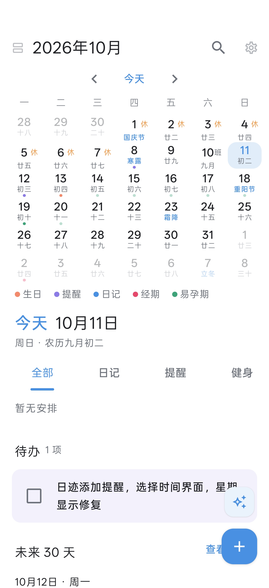
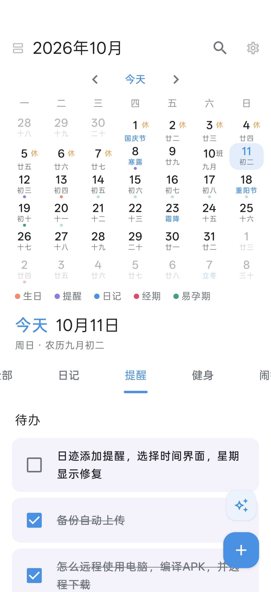
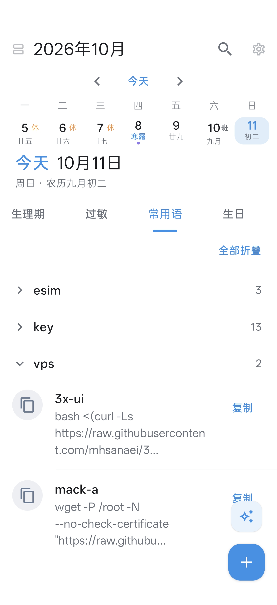
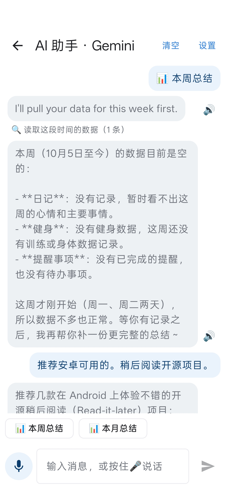
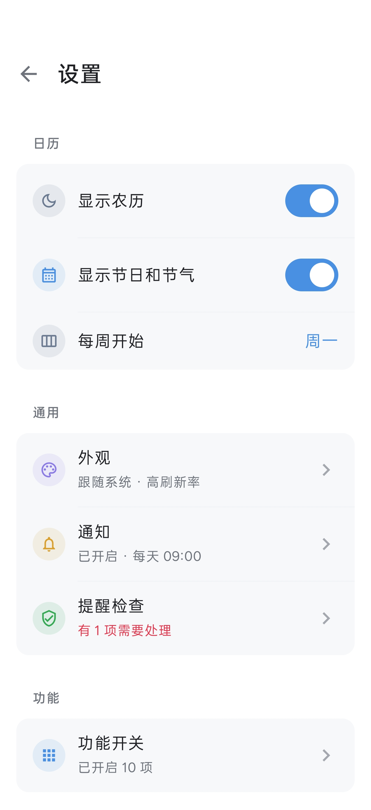
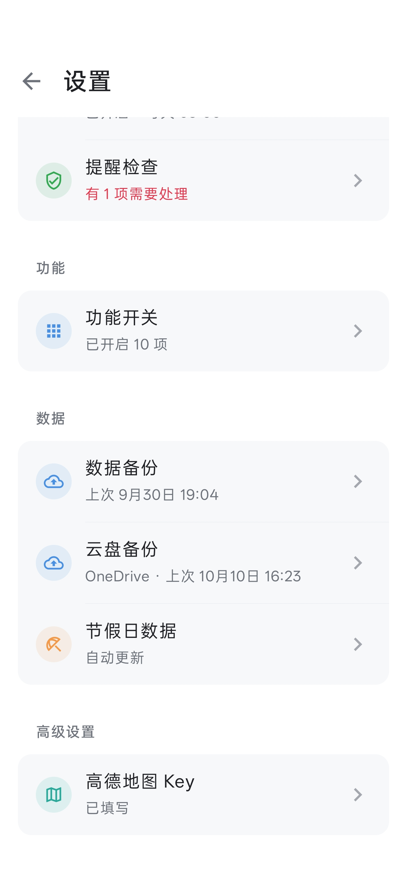

# 日迹

**版本 1.7.5**（更新记录见 [CHANGELOG.md](CHANGELOG.md)）

日迹是一个以日历为中心的安卓记录应用：农历、节假日和调休一眼看清，生日、提醒、闹钟、日记、学习、健身、用药、生理期都记在同一个地方，按日期串成每天的时间轴。
不用注册登录，数据只存在手机里（以及你自己设置的云盘里）。支持 Android 7.0 及以上。

## 截图

| 日历首页 · 全部 | 日历首页 · 提醒 | 往上滑收成一周 · 常用语 |
|---|---|---|
|  |  |  |

| AI 助手 | 设置 | 设置（续） |
|---|---|---|
|  |  |  |

## 下载安装

到 [Releases](https://github.com/clusflah/riji/releases/latest) 下载最新的 APK，有两个版本，任选一个装：

| 文件 | 说明 |
|---|---|
| `riji-<版本>-full.apk` | 完整版，全部功能 |
| `riji-<版本>-noAllergy.apk` | 无过敏记录版：少了“过敏记录”，其它完全一样 |

两个版本的应用名、图标、包名相同，一台手机上只能装一个；互相覆盖安装时数据保留。以后升级直接下载新版覆盖安装即可。

> 以前装过调试版或旧签名的版本，换成正式版时不能直接覆盖：先在 设置 → 数据备份 里导出备份（或做一次云盘备份），卸载旧版，装上新版后再恢复。

第一次打开后，建议去 设置 → **提醒检查** 看一眼：通知、精确闹钟、全屏通知、电池优化有没有被系统限制，不对的地方可以一键跳过去改，还能发一条测试通知。很多手机默认会在后台杀应用，不处理的话提醒和闹钟可能不准时。

## 首页怎么用

首页就是日历，上面是月历，下面是日程区域。

- **月历**：每格显示公历、农历、节日节气，法定假期标“休”，调休补班标“班”，有记录的日子下面有彩色小圆点（生日、提醒、日记、学习、经期等各有颜色）。左右滑动翻月，点“今天”回到今天。
- **收成一周**：往上滑下面的内容，月历收成只剩选中那一周，日程区域变大；滑回顶部就展开。
- **日程区域**：选中哪天就显示哪天。最前面的标签是“全部”——当天的事排成一条时间轴，全天的（生日、健身、过敏等）在上，提醒、闹钟、日记、学习按时间排，下面还有“未来 30 天”。后面是各项目的标签（日记、提醒、学习、健身、闹钟、用药就医、生理期、过敏、常用语、生日），点标签或左右滑动切换，直接看那一项的全部数据。
- **日程视图**：点年月左边的小图标，切换成按月、按周分组的连续列表，往前最多看五年、往后两年。
- **“+”按钮**：在“全部”时打开添加面板，选要记什么；在具体项目的标签里，直接进那一项的添加页。
- 右上角是**搜索**和**设置**，“今天”那一行最右边是 **AI 助手**。

## 功能

### 生日

- 公历或农历生日（支持闰月），出生年份可以不填，填了会显示“将满 N 岁”。
- 提前提醒可多选：当天、提前 1 / 3 / 7 天，在设置里的“每日提醒时间”通知。
- 农历三十遇到小月按二十九过；2 月 29 日出生的，平年在 2 月 28 日过。

### 提醒和待办

- **有日期的提醒**：日期 + 指定时间或全天；重复可选不重复 / 每天 / 每周 / 每月 / 每年 / 自定义周期（每 N 天、周、月、年）；准时提醒或提前 10 分钟 / 1 小时 / 1 天。
- **无时间待办**：没有日期、不发通知，做完打个勾就行。
- 重复的提醒每一次单独打勾；通知上可以直接点“完成”或“10 分钟后提醒”。

### 闹钟

- 重复方式：仅一次、每天、工作日、休息日、自定义周几。
- “工作日 / 休息日”按法定节假日和调休判断：放假的日子工作日闹钟不响，周末补班那天会响。
- 稍后提醒（5 / 10 / 15 / 30 分钟或不要）、振动、铃声可选系统默认或本机任意音频（可试听）。
- 系统拦着不让响铃界面启动时（厂商后台限制等），会改发一条闹钟级别的通知兜底，一样会响。

### 日记

- 所见即所得：大标题、小标题、加粗、斜体、划线、圆点 / 数字 / 横线列表、待办、引用、表格。
- 可插入图片、附件；可添加位置（高德地图搜索、地图上点选或手机定位，需要先填高德 Key，见下文）。
- ✨ **AI 润色**：选一段文字让 AI 改写，满意再替换。
- **快捷心情**：日记标签顶上点一下表情就记一次心情，一天可以记多次、可撤销。点“统计”看心情起伏曲线、心情概览和周一到周日的分布，可选 1 个月 / 6 个月 / 1 年 / 全部。

### 学习

- 一条记录里可以记好几项内容（名称、数量、单位），再加学习时长和开始时间；单位可以按题、套、遍，也可以按分钟 / 小时记时间，时长没填就按合计算。
- 常用项目点一下就加一行；记录里每行右边的 ☆ 能存成常用项目。
- 每天定时的学习提醒；今天 / 本周 / 本月统计和连续学习天数。
- **从日记导入**：以前写在日记里的“逻辑填空 20 图推 15”这类内容可以识别出来，每篇变成一条学习记录，日记本身不动。

### 健身和身体数据

- 每天的训练按组记录，冲极限的那一组单独记；常做的训练可以存成组合，下次一键填入。
- 显示个人最佳、连续训练天数、最近 7 天；训练项目的顺序、显示与否可以自定义，也能加自己的项目。
- 身体数据：体重（带曲线和 BMI）、身高、围度、心率、睡眠、血压、血氧等。
- 可以从 **Health Connect** 同步心率、睡眠、体重、身高、体脂、血压、血氧：手环 / 手表 / 体脂秤的 App 先把数据写进 Health Connect，日迹再读过来，只填空着的项，不覆盖手动填的。

### 过敏记录（完整版）

- 每天记眼睛、鼻子过敏和咳嗽的程度，加备注（用药、诱因等），能看最近 30 天的情况。

### 用药就医

- **药品**：名称、剂量和单位（片、粒、滴、喷……）、多个服药时间；重复可选每天、每周几、每隔几天、吃几天停几天，可设开始和结束日期。
- 到点通知，点“已服用”打卡，也能跳过、补记、临时加一次；显示最近 7 天 / 30 天服药率。
- 库存和有效期：服用后自动扣库存，低于设定数量时提醒补药，快过期会提示。
- **就医记录**：医院、科室、医生、症状、诊断、医嘱、这次开的药、病历和检查单照片（最多 9 张）、复诊时间。复诊前一天晚上 8 点和当天早上 9 点各提醒一次，复诊也会显示在日历里。
- 可以导出最近 90 天的服药和就医记录（CSV），看病时给医生看。

### 生理期

- 点日历上的某一天记录：是否经期、流量（选填）、症状、心情、分泌物、备注。标了一次经期的第一天，后面按设定的经期天数自动标好，可以再一天天改。
- 根据最近几个周期预测下次经期、易孕期和排卵日，显示平均周期和经期长度、周期历史、最近 90 天常见症状；可设经前期和排卵日提醒。
- **避孕模式**：不显示、不提醒易孕期和排卵日。配合避孕药打卡：药板进度、停药期、连续服药天数、最近 7 天、本月服药率，服药历史可以改。避孕药从“用药就医”的药品里选。
- 可导出 CSV。
- 预测只按平均周期估算，仅供参考，不能作为避孕或诊断依据。

### 常用语

- 标题 + 内容，可分类，按分类分组、可全部展开 / 折叠，点一下复制。适合存学号、邮箱、地址、证件号这类经常要复制粘贴的信息。

### 隐私空间

- 不想被别人看到的内容放进隐私空间：**按住首页的年月标题约 2 秒**，验证指纹（或锁屏密码）后进入。
- 在隐私空间里点“+”新建的都是私密的：日记、提醒、生日、常用语、健身、过敏、闹钟、用药就医都可以，生理期还有一份完全独立的私密记录。
- 私密内容不会出现在外面的日历、列表、搜索、AI 助手、桌面小组件和通知里；应用退到后台超过 1 分钟会自动上锁，私密页面不能截屏。
- 导出备份、打开自动备份 / 云盘备份前都要先验证身份。

### 搜索

- 首页右上角的放大镜：在日记、提醒、生日、常用语里搜，多个关键词用空格隔开，会找同时包含这些词的内容。

### AI 助手

- 支持 OpenAI、Claude、Gemini、Grok、DeepSeek，在助手页右上角的设置里选服务商、填 API Key、选模型，可以先“测试连接”。
- 直接说话办事：比如“明天下午 3 点提醒我开会”“提前一天提醒我妈妈农历八月十五的生日”，AI 列出要添加的内容，你点“确认”才会真的加上。也可以问它查生日、提醒、闹钟、日记、健身和过敏记录。
- 一键生成 **本周总结 / 本月总结**。
- 按住 🎤 说话输入，回复可以朗读；语音服务可选 Azure、Gemini、Google 或手机自带的系统语音。
- API Key 和对话记录只存在本机。关掉的功能和私密内容 AI 都碰不到。

### 桌面小组件

- 在桌面长按空白处 → 小组件 → 日迹，有 4×3、4×2、2×2 三种，放上去时选要显示的内容：日历、生日、提醒、闹钟、日记、健身、过敏、今天的用药、生理期状态、常用语。
- 可以长按拖动改大小，内容随尺寸自动调整；点小组件跳到对应页面。数据有变化时自动刷新。

### 节假日

- 法定节假日和调休补班数据会自动联网更新（也可以在 设置 → 节假日数据 里手动更新），闹钟的工作日判断、月历上的“休 / 班”都用它。
- 可开“节假日与补班提醒”：放假和补班的前一天提醒你。

## 设置

| 分组 | 内容 |
|---|---|
| 日历 | 显示农历、显示节日和节气、每周从周日或周一开始 |
| 通用 | 外观（跟随系统 / 浅色 / 深色、高刷新率）；通知（系统通知开关、每日提醒时间、新建生日的默认提前提醒、节假日与补班提醒）；提醒检查 |
| 功能 | 功能开关：不用的项目（日记、提醒、健身、学习、闹钟、过敏、用药就医、生理期、常用语、生日、AI 助手）可以整个关掉，关掉后界面、提醒、小组件、AI 里都不再出现，数据保留，重新打开就回来 |
| 数据 | 数据备份、云盘备份、节假日数据 |
| 高级设置 | 高德地图 Key |

## 备份与换手机

- **手动备份**：设置 → 数据备份 → 导出备份，得到一个 `.zip`（全部数据、设置、AI Key、图片、附件、自定义铃声）；在新手机上“从备份恢复”即可。旧版本导出的 `.json` 备份也能恢复。
- **自动备份到文件夹**：选一个文件夹（比如网盘 App 的同步文件夹），按每天或每周，到时间后打开应用就自动备份一份，只保留最新 7 份。
- **云盘备份**：设置 → 云盘备份，支持 OneDrive、百度网盘和 WebDAV（坚果云、Nextcloud、群晖、Koofr 等）。每天或每周在后台自动上传，可限制仅 Wi-Fi、仅充电时，云盘上只保留最新 3 / 7 / 15 份，也可以立即上传或从云盘恢复。各家云盘的设置步骤见 [CLOUD_BACKUP.md](CLOUD_BACKUP.md)。
- 云盘的登录信息（OneDrive、百度网盘的登录令牌，WebDAV 密码）用系统密钥库加密保存在手机里，不放进备份文件，换手机后重新登录一次即可。
- 备份文件里的内容是不加密的，请放在自己信得过的地方。

## 高德地图 Key

日记的“添加位置”需要高德 **Web 端（JS API）** Key：到 [高德开放平台](https://console.amap.com) 免费申请（个人使用免费额度够用），新申请的 Key 通常还要一个“安全密钥 JSCode”。填在 设置 → 高德地图 Key，只保存在本机。不用这个功能可以不填。

## 隐私和权限

日迹没有开发者服务器，不收集任何数据。只有你主动使用下面这些功能时才会联网：节假日数据更新、AI 助手和语音、日记里的地图、云盘备份——数据直接发给你自己选的服务商。

用到的权限：

| 权限 | 用途 |
|---|---|
| 通知 | 生日、提醒、用药、生理期、学习等通知 |
| 精确闹钟、开机自启 | 让提醒和闹钟准时，重启手机后重新排好 |
| 前台服务、全屏通知、振动、唤醒 | 闹钟响铃和锁屏弹出响铃界面 |
| 忽略电池优化 | 防止系统在后台杀掉应用导致闹钟不响 |
| 定位 | 只在日记里点“定位”时用 |
| 麦克风 | 只在 AI 助手按住说话时用 |
| 联网 | 节假日更新、AI、地图、云盘备份 |
| Health Connect（只读） | 同步身体数据时用 |

## 说明

- 用药提醒只是辅助工具，不能代替医生的建议，用药请遵医嘱。生理期预测仅供参考。
- 用药就医的功能设计参考开源项目 [MedTimer](https://github.com/Futsch1/medTimer)（Copyright (c) Futsch1，MIT 许可证），生理期的功能设计参考 [Mooneva Cycle](https://github.com/aradar46/Mooneva-Cycle-Private-Period-Tracker)（GPL-3.0），都只参考了功能设计，按日迹自己的结构重新实现，没有复制它们的源代码。
- 节假日数据来自 [holiday-cn](https://github.com/NateScarlet/holiday-cn)。
- 代码结构等开发说明见 [docs/DEVELOPMENT.md](docs/DEVELOPMENT.md)。

## 许可证

本项目以 [MIT 许可证](LICENSE) 发布。
